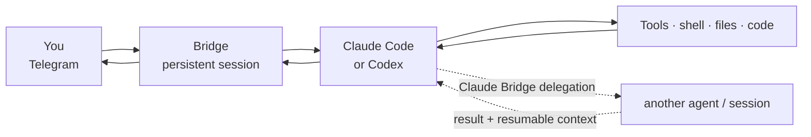
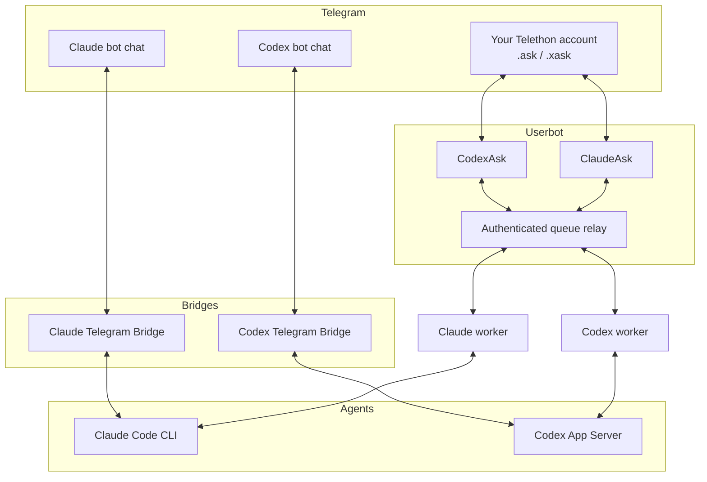

# Telegram AI

### Claude Code and OpenAI Codex, carried in your pocket.

Persistent coding-agent sessions from Telegram, using your existing subscriptions rather than metered API keys.

Watch work happen live. Steer Codex mid-turn. Resume native sessions later. Move files in both directions. Let the agents work on the machine where your projects actually live.

[Claude Bridge](https://github.com/maleon17/claude-telegram-bridge) · [Codex Bridge](https://github.com/maleon17/codex-telegram-bridge) · [ClaudeAsk](https://github.com/maleon17/claude-ask) · [CodexAsk](https://github.com/maleon17/codex-ask)

---

## More than “AI in Telegram”

The bridge projects turn Telegram into a **remote engineering console** for Claude Code and Codex. They run persistent CLI/App Server processes and preserve native sessions across restarts instead of treating every message as a stateless API call.

The userbot projects take the other route: invoke Claude or Codex **inside ordinary Telegram conversations** through your own Telethon account, with real Telegram actions exposed through MCP.

## The ecosystem

| | **Bot API bridge** | **Userbot / inline assistant** |
|---|---|---|
| **Claude Code** | **[claude-telegram-bridge](https://github.com/maleon17/claude-telegram-bridge)** Persistent Claude sessions, live tool progress, permission modes, isolated accounts and file delivery. | **[claude-ask](https://github.com/maleon17/claude-ask)** Use `.ask` from ordinary chats; a Claude Code worker resumes each chat's session and can perform Telegram actions through your Telethon session. |
| **OpenAI Codex** | **[codex-telegram-bridge](https://github.com/maleon17/codex-telegram-bridge)** Persistent Codex App Server threads, compaction, sandbox/model controls, isolated accounts and file delivery. | **[codex-ask](https://github.com/maleon17/codex-ask)** Use `.xask` inline, backed by persistent Codex threads and the Telegram-action layer. |

They are intentionally separate projects. Install one, mix two, or run the whole mildly unreasonable machine.

## Choose and install

Use a **bridge** for a dedicated bot conversation with the coding agent. Use a **userbot** to invoke `.ask` or `.xask` inside your existing chats through your own Telegram account; it edits your message in place with the answer. The two approaches can run side by side.

Each repository has its own `setup.sh` and installation guide. The userbots also require a Telethon/Hikka host, their backend worker and the shared authenticated `cmd_queue.py` relay; follow the selected userbot repository's README for the deployment order.

## How it feels

A turn is not a black box. Progress and tool activity are visible while work happens. Codex Bridge also accepts new input during an active turn, so the user can correct assumptions before the agent has enthusiastically automated the wrong thing.

## What you can do from the phone

- **Keep real sessions alive.** Create, list and resume native Claude/Codex sessions; state survives bot restarts.
- **Watch work live.** Tool calls and progress are streamed while the agent works.
- **Control the runtime.** Change model, reasoning effort, workspace and the bridge's permission or sandbox policy without SSH.
- **Move actual artifacts.** Send photos and documents to the agent and receive generated files back.
- **Interrupt safely.** Stop active work, compact context, or use deferred restarts.
- **Use multiple accounts.** Isolate whitelisted users into separate accounts, sessions and subscription limits.
- **Act inside Telegram.** The `*-ask` projects expose Telegram actions through the user's Telethon session.
- **Delegate through Claude Bridge.** Its optional `bridge_exec.py` path returns the result and a session ID for resuming delegated work.

## Architecture

## Philosophy

**The phone should be a control surface, not the computer doing the work.**

The agents stay on the host with the repositories, shell, tools and persistent sessions. Telegram provides the human loop: give direction, observe progress, correct assumptions, approve or stop work, and receive the result.

The point is not to squeeze a coding CLI into a chat bubble. It is to make a remote agent workflow practical enough to use every day.

## Contributing

Changes belong in the repository that owns the feature. Fork that repository and open a PR there. The projects are kept independent on purpose, so improvements should not create unnecessary cross-repository coupling.
