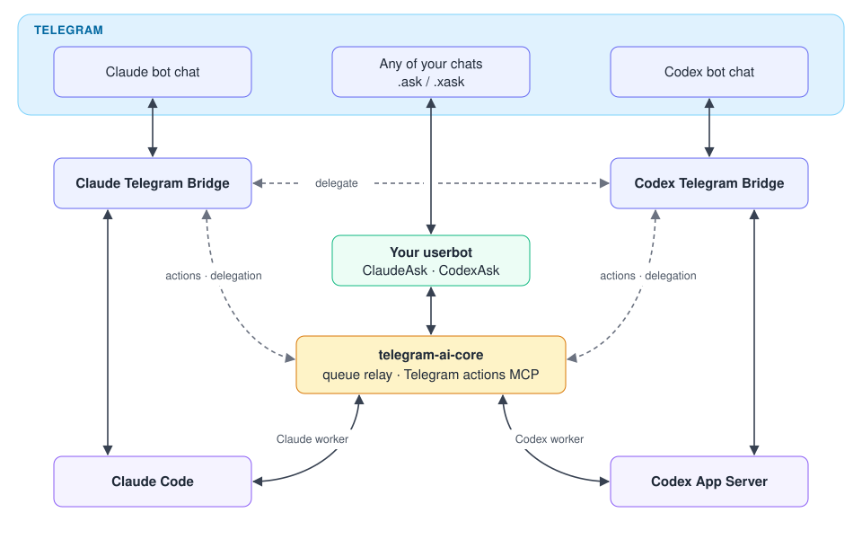

# Telegram AI

### Claude Code and OpenAI Codex, carried in your pocket.

Coding agents on your own server, driven from Telegram — on the subscriptions you already pay for, not metered API keys.

Watch work happen live. Steer it mid-turn. Resume sessions later. Move files both ways. Let the agents work on the machine where your projects actually live.

[Claude Bridge](https://github.com/maleon17/claude-telegram-bridge) · [Codex Bridge](https://github.com/maleon17/codex-telegram-bridge) · [ClaudeAsk](https://github.com/maleon17/claude-ask) · [CodexAsk](https://github.com/maleon17/codex-ask) · [Core](https://github.com/maleon17/telegram-ai-core)

---

## Two ways to use it

**A bridge** gives the agent its own bot chat — a remote engineering console. You message the bot; Claude Code or Codex works on your server and reports back with live progress, files and full session control.

**A userbot** puts the agent inside the chats you already have. Type `.ask` (Claude) or `.xask` (Codex) anywhere — the answer replaces your message as if you had written it, and the agent can act in your Telegram account: read history, send messages, run groups, watch chats with triggers.

| | **Bot chat (bridge)** | **In your own chats (userbot)** |
|---|---|---|
| **Claude Code** | **[Claude Telegram Bridge](https://github.com/maleon17/claude-telegram-bridge)** Persistent sessions, live tool progress, permission modes with approve/deny, isolated accounts, files and voice. | **[ClaudeAsk](https://github.com/maleon17/claude-ask)** `.ask` in any chat, a resumable session per chat, real Telegram actions, triggers. |
| **OpenAI Codex** | **[Codex Telegram Bridge](https://github.com/maleon17/codex-telegram-bridge)** Persistent App Server threads, mid-turn steering, sandbox and model control, isolated accounts, files. | **[CodexAsk](https://github.com/maleon17/codex-ask)** `.xask` in any chat, persistent Codex threads, real Telegram actions, triggers. |

## Which one should I install?

- *"I want to code from my phone."* → a **bridge**. Start with whichever agent you already pay for.
- *"I want an assistant in my Telegram conversations."* → **ClaudeAsk** or **CodexAsk**. You need a [Heroku](https://github.com/coddrago/Heroku) userbot; their installer can set one up in Docker for you.
- *"Both, and they should work together."* → install several on one server. Order does not matter.

Every project installs with one command — `./setup.sh` in its repository — and works on its own. The userbots fetch **[telegram-ai-core](https://github.com/maleon17/telegram-ai-core)**, their shared engine, by themselves. The install guides clone into hidden folders in your home directory (for example `~/.claude-ask`) to keep it tidy; each installer records where it lives in a shared registry, so the parts find each other wherever they are.

## What you need

- A Linux server with `systemd`, `git` and Python 3.10+.
- The agent you want, logged in on that server: [Claude Code](https://claude.com/claude-code) with a Claude subscription, and/or the [Codex CLI](https://developers.openai.com/codex/cli/) with ChatGPT.
- For a bridge: a bot token from [@BotFather](https://t.me/BotFather).
- For ClaudeAsk / CodexAsk: a [Heroku](https://github.com/coddrago/Heroku) userbot. The installer can create one in Docker on the same server; one on another server connects over [Tailscale](https://tailscale.com), which the module installs and logs in by itself — you only open the login link it sends.

## Better together

Installed on the same server, the parts find each other automatically and add:

- **Bridge ↔ bridge** — Claude can hand a task to Codex (and back) for the same user, wait for the answer and carry on with it.
- **Bridge → your Telegram account** — if you own a userbot, the agent in *your* chat with either bridge can act in your account through it.
- **Userbot → bridge** — `.ask` / `.xask` can pass a bigger job to your coding agent in a bridge, which has your projects and no time limit, and bring back its answer.
- **ClaudeAsk + CodexAsk** — shared triggers with one coordinated reaction per message, and automatic fallback to the other engine on failure.

Each person only ever reaches their own accounts: who owns which userbot is decided on the server, not by the model, and automated triggers can never delegate work.

## Architecture

<picture>
  <source media="(prefers-color-scheme: dark)" srcset="docs/architecture-dark.svg">
  
</picture>

## Philosophy

**The phone should be a control surface, not the computer doing the work.**

The agents stay on the host with the repositories, shell, tools and persistent sessions. Telegram provides the human loop: give direction, observe progress, correct assumptions, approve or stop work, and receive the result.

The point is not to squeeze a coding CLI into a chat bubble. It is to make a remote agent workflow practical enough to use every day.

## Contributing

Changes belong in the repository that owns the feature — fork it and open a PR there. The userbot modules for both ClaudeAsk and CodexAsk are built from one template in telegram-ai-core, so module changes go there.
